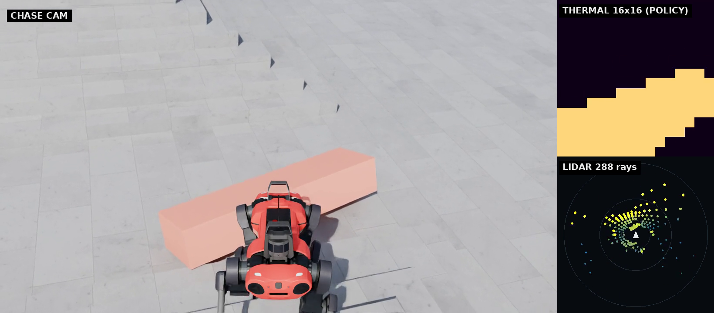
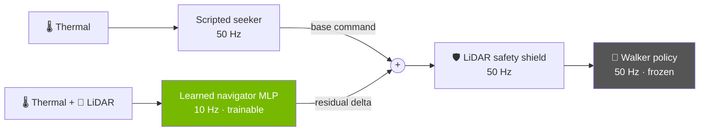
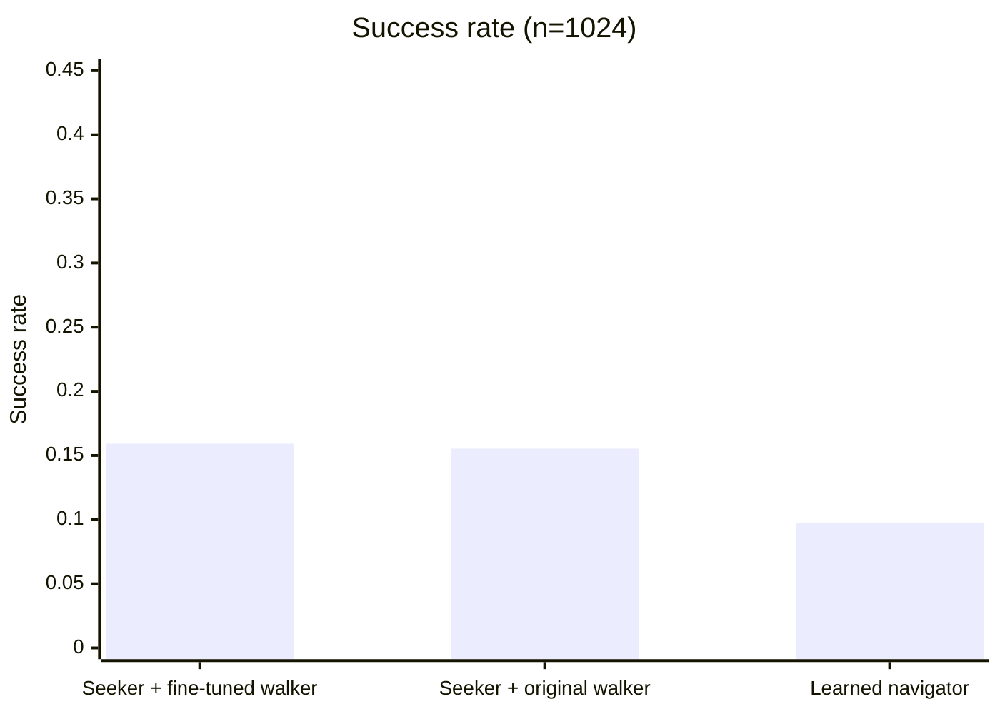
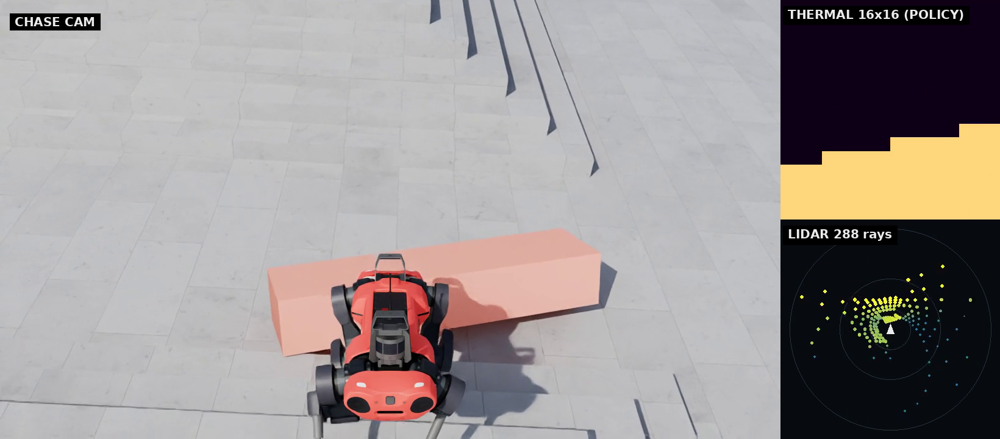

# 🐕‍🦺 Rescue Robot — teaching a quadruped to search a disaster scene


-blue)


An **ANYmal-C** quadruped carrying a **thermal camera**, a **288-ray LiDAR** and an
**emergency supply payload** is dropped into a rubble-strewn disaster scene. It has
**20 seconds** to find and reach a casualty. All of it was trained with deep reinforcement learning
in NVIDIA Isaac Lab on cloud GPUs, over five days (2026-08-12 → 08-16).



<sub>Left: what an observer sees. Right: **what the robot actually senses**: a 16×16
pseudo-thermal image (the casualty fills the panel) and a 288-ray LiDAR sweep. The policy never sees the left panel.</sub>

---

## ✨ Highlights

- **Full sensor-equipped rescue robot:** thermal camera + LiDAR + 2–12 kg randomized payload, trained over rough terrain and debris.
- **Two-stage curriculum:** walk first, then search. Single-stage training "farmed" casualties on flat ground (terrain level 0.25 vs **3.72**).
- **Hierarchical control stack:** a frozen walker, a LiDAR safety shield, a scripted seeker and a learned navigator.
- **Honest benchmarking:** every claim carries a significance test, sample size is fixed per comparison, and negative results are kept. See [`MISTAKES.md`](MISTAKES.md).

## 🤖 The robot

| Component | Model in simulation |
|---|---|
| Body | ANYmal-C quadruped (~30 kg trunk) |
| Thermal camera | 16×16 pseudo-thermal (RTX segmentation pass), rendered at ¼ policy rate |
| LiDAR | 288 rays, also drives a hard safety shield |
| Emergency supply | Randomized added mass (2–12 kg) + rotational inertia |
| Brain | PPO policies (RSL-RL), 4096 parallel environments |

> **Why only 16×16?** At 64×64 the camera made up 94% of the observation vector, and the policy
> collapsed (episode length fell to 7.76 steps, 100% crashes). 16×16 fixed it.

## 🧠 Control stack



- The **navigator runs at 10 Hz**, so that with γ=0.99 the discount horizon covers ~10 s of a 20 s episode instead of ~2 s.
- The **shield sits outside the network**. It vetoes forward motion inside a ±25° cone at 1.0 m, and no amount of training can remove it. That makes it possible to *test* whether the policy learned obstacle avoidance.
- The **walker is frozen** after ~5200 training iterations, which is what made the navigator phase affordable.

## 📊 Results

Success rate, **n = 1024 episodes** each, debris scene, two casualties, 20 s limit:



| n = 1024 | Success | Fall rate |
|---|---|---|
| **Scripted seeker + fine-tuned walker (best)** | **0.159** | 0.491 |
| Scripted seeker + original walker | 0.155 | 0.525 |
| Learned navigator (init fixed) | 0.098 | 0.381 |

**In plain English:** dropped into the debris scene, the robot reaches a casualty ~16% of the time and falls in about half of attempts.
A 40-line hand-written seeker beat every learned navigator. The project traces exactly why:

1. **The residual was never a residual.** The navigator was meant to start identical to the seeker, but its output layer had default init: **15%** of the command range instead of **0.86%** with zero-init.
2. **The objective was circular.** The navigator was rewarded for the walker *tracking the navigator's own command*. It scored 93% on its own exam (reward nearly doubled) while actually finding fewer casualties. This is specification gaming.

### What the rubble costs

One checkpoint, one session, n = 1024, with only the debris toggled:

| | Debris ON | Debris OFF |
|---|---|---|
| Success | 0.160 | **0.227** |
| Fall rate | 0.525 | **0.275** |

Rubble costs **6.6 points of success and 25 points of fall rate** (p = 0.0001).


<sub>No-rubble scene, shown only to illustrate this comparison. It is easier than the scene every headline number is measured on.</sub>

## 🗂️ Repository layout

```
src/anymal_c_rescue/     Isaac Lab task package (envs, rewards, thermal sensor, seeker, navigator)
harness/                 Train / eval / deploy / demo-rendering scripts
artifacts/benchmarks/    Phase reports + eval JSONs + training logs
artifacts/presentation/  Slide content, eval data (CSV/JSON), hero frames
MISTAKES.md              What went wrong and how it was caught
```

Registered gym tasks:

| Task ID | Purpose |
|---|---|
| `Isaac-Rescue-Anymal-C-v0` / `-Play-v0` | Full rescue policy (thermal + LiDAR + payload) |
| `Isaac-Rescue-Anymal-C-NoCam-v0` | LiDAR-only ablation |
| `Isaac-Rescue-Anymal-C-Locomotion-v0` | Stage 1: locomotion curriculum |
| `Isaac-Rescue-Anymal-C-Nav-v0` / `-Nav-Play-v0` | Hierarchical navigator |

## 🚀 Running it

Requires Linux + an RTX GPU that can create a Vulkan instance (the thermal camera needs the RTX renderer).

```bash
# 1. Build Isaac Sim + Isaac Lab on the GPU host
harness/setup_isaac.sh

# 2. From your machine: push the task package into Isaac Lab's task tree (auto-registers the envs)
HOST=<gpu-host> harness/deploy_task.sh

# 3. Train (on the host, inside the Isaac Lab checkout)
./isaaclab.sh -p scripts/reinforcement_learning/rsl_rl/train.py \
    --task Isaac-Rescue-Anymal-C-v0 --headless

# 4. Evaluate: success rate, SPL, time-to-find, fall rate
./isaaclab.sh -p harness/eval_rescue.py --task Isaac-Rescue-Anymal-C-v0 ...
```

Checkpoints (`*.pt`) and videos are not committed. They live on the training host.

## 📚 Deep dives

| Report | What's in it |
|---|---|
| [Phase 2: locomotion baseline](artifacts/benchmarks/phase2_baseline.md) | Throughput, GPU headroom, baseline training |
| [Phase 3/4: rescue policy](artifacts/benchmarks/phase3_rescue.md) | Sensor suite, thermal resolution, two-stage curriculum |
| [Phase 5: hierarchical navigator](artifacts/benchmarks/phase5_navigator.md) | Navigator design, root causes, debris A/B |
| [Presentation pack](artifacts/presentation/slides_content.md) | Slide-by-slide story with all figures |
| [Mistakes](MISTAKES.md) | Every error, how it was caught, and the pattern behind them |

## 🔭 Next steps

1. Train the walker on debris properly (1200+ iterations, not a 500-iteration fine-tune). This is the biggest measured gap.
2. Give the navigator its own reward: victim terms + fall penalty, never the walker's tracking terms.
3. Add memory, so a casualty hidden behind rubble isn't forgotten instantly.
4. Run more seeds. Every number here is from one training run.

---

<sub>Built with NVIDIA Isaac Sim / Isaac Lab and RSL-RL. Trained on RunPod (RTX PRO 6000) and Massed Compute (L40S) cloud GPUs.</sub>
